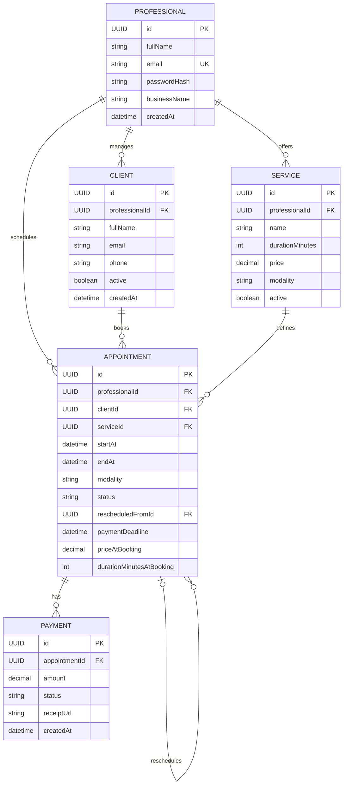

# Nexora API — Data Model

## 1. Overview

Nexora utiliza un modelo de datos relacional para gestionar profesionales, clientes, servicios, turnos y pagos.

El objetivo es mantener la integridad de la información, conservar el historial de operaciones y permitir la evolución futura del sistema.

## 2. Main entities

### Professional
Representa al profesional que utiliza Nexora.

- id (UUID)
- fullName
- email
- passwordHash
- businessName
- createdAt

### Client
Representa a un cliente asociado a un profesional.

- id (UUID)
- professionalId (FK)
- fullName
- email
- phone
- notes
- active
- createdAt

### Service
Representa un servicio ofrecido por un profesional.

- id (UUID)
- professionalId (FK)
- name
- description
- durationMinutes
- price (BigDecimal)
- modality (IN_PERSON, ONLINE, BOTH)
- active

### Appointment
Representa un turno reservado por un cliente.

- id (UUID)
- professionalId (FK)
- clientId (FK)
- serviceId (FK)
- startAt
- endAt
- modality
- status
- meetingLink
- rescheduledFromId (FK opcional)
- cancellationReason
- paymentDeadline
- priceAtBooking (BigDecimal)
- durationMinutesAtBooking
- createdAt

### Payment
Representa un pago asociado a un turno.

- id (UUID)
- appointmentId (FK)
- amount (BigDecimal)
- status (PENDING_REVIEW, APPROVED, REJECTED)
- receiptUrl
- reviewedAt
- rejectionReason
- createdAt

## 3. Relationships

- One Professional has many Clients.
- One Professional has many Services.
- One Professional has many Appointments.
- One Client can have many Appointments.
- One Service can be associated with many Appointments.
- One Appointment can have payment records.
- One Appointment can reference a previous Appointment when it is rescheduled.

## 4. Entity Relationship Diagram

## 5. Important design decisions

- UUID will be used as the identifier for entities.
- BigDecimal will be used for monetary values to avoid floating-point precision errors.
- Clients and services will use soft deletion through an active field.
- Appointments will preserve the price and duration agreed upon at booking time.
- Rescheduling will preserve the relationship with the previous appointment.
- Payment history must be preserved and must not be overwritten when an appointment is rescheduled.
- Appointment rescheduling and payment handling require a transactional approach.
- Date and time values must be handled consistently with timezone information.

## 6. Pending technical decision

The relationship between payments and rescheduled appointments needs to be defined before implementation, especially when an appointment already has an approved payment.

The design must preserve the complete payment history and prevent duplicate charges or loss of payment information.

## 7. Current status

Initial conceptual data model. Relationships and constraints will be refined before database implementation.
